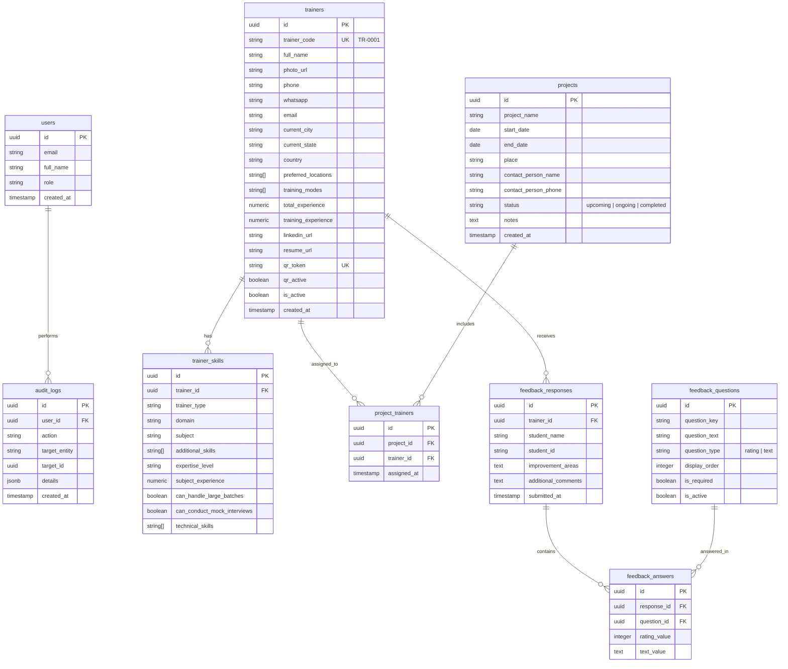

# EdRealm — Product Requirements Document (MVP)

## 1. Overview

EdRealm is a centralized platform designed to streamline trainer discovery, onboarding, project-based trainer assignment, and student feedback collection.

The MVP is organized around **two core administrative domains**:

1. **Trainers Module** — Comprehensive trainer profiles, subject expertise, multi-filter search, trainer-unique feedback QR codes, and integrated student ratings & reviews.
2. **Projects Module** — Create and manage training engagements/drives, track timeline and venue details, and assign multiple trainers to each project.

### Core Architectural Principles
* **Trainer-Centric QR Codes**: Feedback QR codes are generated uniquely **per trainer** and are completely decoupled from projects. Scanning a QR code submits feedback directly to that specific trainer's profile.
* **Unified Trainer Profile**: A trainer's profile is the single source of truth—displaying personal details, skills, unique QR code, and aggregated ratings/feedback.
* **Streamlined Projects**: Projects focus on operational assignment (which trainers are assigned to which training drive) without the overhead of multi-batch scheduling for the MVP.

### Out of Scope (MVP)
* Multiple batch/session scheduling within projects (single project scope for MVP)
* Trainer availability calendar & automated scheduling
* Trainer project history ledger & payroll / payment tracking
* Automated trainer recommendation algorithms
* Advanced SMS / email notification pipelines

---

## 2. Module 1 — Trainer Database & Profiles

### 2.1 Personal Information

Each trainer profile captures the following core personal and professional attributes:

| Field | Type | Example |
|---|---|---|
| Trainer ID | Auto-generated | TR-0001 |
| Full Name | Text | Rahul Sharma |
| Trainer Photo | Image Upload | JPEG/PNG (max 2 MB) |
| Phone Number | Phone | +91 XXXXX XXXXX |
| WhatsApp Number | Phone | +91 XXXXX XXXXX |
| Email | Email | rahul@example.com |
| Current City | Dropdown/Text | Hyderabad |
| Current State | Dropdown | Telangana |
| Country | Dropdown | India |
| Preferred Work Locations | Multi-select | Hyderabad, Vijayawada, Bengaluru |
| Training Mode | Multi-select | Offline, Online, Hybrid |
| Total Experience | Number | 6 years |
| Training Experience | Number | 4 years |
| LinkedIn Profile | URL | https://linkedin.com/in/... |
| Resume | File Upload | PDF |
| Date Added | Auto-generated | 17-10-2026 |
| Profile Status | Dropdown | Active, Inactive |

### 2.2 Subject Expertise

A trainer can possess multiple skills. Each skill is stored as an independent record linked to the trainer.

| Field | Type | Example |
|---|---|---|
| Skill ID | Auto-generated | SK-0001 |
| Trainer ID | Reference | TR-0001 |
| Trainer Type | Dropdown | Technical, Aptitude, Soft Skills, Domain Expert |
| Domain | Dropdown | Programming & DSA |
| Subject | Dropdown | Java DSA |
| Additional Skills | Multi-select | Core Java, Advanced DSA |
| Expertise Level | Dropdown | Beginner, Intermediate, Advanced, Expert |
| Experience in Subject | Number | 4 years |
| Can Handle Large Batches | Yes/No | Yes |
| Can Conduct Mock Interviews | Yes/No | Yes |
| Technical Skills | Tags | Java, DSA, LeetCode |

#### Initial Subject Categories
Admins can dynamically add new subjects and categories via Admin Settings:
* **Programming**: C, C++, Java, Python
* **DSA**: Basic DSA, Advanced DSA, Competitive Programming, LeetCode
* **Full Stack**: MERN, Java Full Stack, Python Full Stack
* **AI/ML**: Artificial Intelligence, Machine Learning, Generative AI
* **Data**: Data Analytics, Data Science, Data Visualization
* **Cybersecurity**
* **Cloud Computing & DevOps**
* **UI/UX Design**
* **Embedded Systems & IoT**
* **Aptitude & Logical Reasoning**
* **Verbal Ability & Soft Skills**
* **Company-Specific Placement Training**

### 2.3 Trainer Profile View (The Single Source of Truth)

Clicking on any trainer from the directory or search results opens the **Trainer Profile Page**, organized into four distinct sections:

1. **Personal & Professional Details**:
   * Header with photo, name, trainer ID, status badge (Active/Inactive), contact quick-actions (Call, WhatsApp, Email).
   * Key metadata: Experience, training modes, work location preferences, resume viewer/download link, LinkedIn link.
2. **Subject Expertise & Skills**:
   * Card list of all subject records with expertise levels, domain tags, and batch capability indicators.
3. **Trainer's Unique Feedback QR Code**:
   * Prominently displayed permanent QR code tied exclusively to this trainer.
   * Actions: **Preview QR**, **Download PNG**, **Download SVG**, **Print QR Card**, **Copy Feedback Link**.
   * Toggle to **Enable / Disable Feedback** (disabling closes the feedback form for this trainer).
4. **Ratings & Student Feedback**:
   * **Overall Average Rating** (e.g., `4.7 / 5.0`) calculated from live student submissions.
   * **Total Reviews Count** (e.g., `184 student submissions`).
   * **Criteria Breakdown**: Visual rating bars for Concept Clarity, Knowledge, Doubt Clarification, Communication, and Punctuality.
   * **Feedback Stream**: Reverse-chronological list of student submissions, displaying date, ratings, improvement suggestions, and comments.

### 2.4 Trainer Profile Actions (Admin)
* **Edit Profile**: Update personal, contact, and professional details.
* **Edit Skills**: Add, edit, or delete subject expertise records.
* **Update Photo / Resume**: Replace or remove uploaded assets.
* **Activate / Deactivate**: Soft-toggle trainer active status without deleting data.
* **Regenerate QR Token**: Reset the feedback token if the link needs to be cycled.
* **View Audit Log**: Complete timestamped history of administrative edits.

---

## 3. Module 2 — Trainer Search

This module enables admins to rapidly filter and identify suitable trainers for open requirements.

### 3.1 Search Filters
Admins can combine any combination of the following criteria:

| Filter | Options |
|---|---|
| Location / City | Hyderabad, Vijayawada, Bengaluru, etc. |
| State | Telangana, Andhra Pradesh, Karnataka, etc. |
| Trainer Type | Technical, Aptitude, Soft Skills, Domain Expert |
| Subject | Java DSA, Python DSA, AI/ML, MERN, etc. |
| Domain | DSA, Full Stack, AI/ML, Cloud & DevOps, etc. |
| Total Experience | Minimum years |
| Training Experience | Minimum years |
| Expertise Level | Intermediate, Advanced, Expert |
| Minimum Rating | 4.0+, 4.5+, Any |
| Training Mode | Online, Offline, Hybrid |
| Travel Preference | Local, Willing to Travel |
| Profile Status | Active trainers (default) |

### 3.2 Search Results & Actions
Each search result card displays:
* Trainer Name, Photo, ID, Current City, and State.
* Primary Subjects, Total Experience, and Training Mode.
* **Current Average Rating** and **Review Count**.
* Local vs. Outstation indicator relative to search location.

**Quick Actions on Result Card**:
* **View Profile** (navigates to full profile with QR & Feedback).
* **Assign to Project** (quick modal to assign trainer to an active project).
* **Copy Phone Number** & **Contact via WhatsApp**.
* **View Resume** & **Edit Profile**.

### 3.3 Search UX Requirements
* **Geo-Prioritization**: Local city matches are returned first, followed by state-level and regional matches.
* **Sorting**: Sort by Average Rating, Total Experience, or Training Experience.
* **Export**: Export filtered results to Excel/CSV.
* **Pagination**: Scalable server-side pagination with live match counts.

---

## 4. Module 3 — Projects Module

The Projects module allows admins to manage training drives and contracts, track operational timelines, and assign trainers.

### 4.1 "Add New Project" Workflow
Admins can click **"Add New Project"** from the sidebar or projects directory. The creation form captures:

| Field | Type | Required | Description / Example |
|---|---|---|---|
| Project Name | Text | Yes | Name of training engagement *(e.g., "ABC College CRT 2026")* |
| Start Date | Date | Yes | Scheduled project start date |
| End Date | Date | Yes | Scheduled project conclusion date |
| Place | Text | Yes | City, campus venue, or training location *(e.g., "Vijayawada - Main Campus")* |
| Contact Person Name | Text | Yes | TPO / Coordinator / Client POC *(e.g., "Dr. K. Srinivas")* |
| Contact Person Number | Phone | Yes | Contact phone number *(e.g., "+91 98765 43210")* |
| Notes / Requirements | Text | No | Optional training syllabus notes or remarks |

> [!NOTE]
> Upon form submission, the system creates the project record and **immediately redirects the admin to the Project Dashboard**.

### 4.2 Project Dashboard (Post-Creation View)
The Project Dashboard provides a complete operational command center for a single project:

1. **Project Summary Header**:
   * Project Name, Place, Start Date, End Date, and calculated Duration.
   * **Project Status Badge**: `Upcoming`, `Ongoing`, or `Completed` (computed from current date vs. date range, with manual override option).
   * Contact Person details with one-click call/WhatsApp actions.
2. **Assigned Trainers Section**:
   * **Assign Trainer Action**: A searchable modal/dropdown allowing admins to quickly select and add trainers from the active Trainer Database.
   * **Assigned Trainers Table**:
     * Trainer Name & Photo
     * Primary Subject & Expertise
     * Contact Number
     * Current Average Rating
     * Action to **Remove / Unassign** trainer from the project.
3. **Project Actions**:
   * **Edit Project Details** (update dates, place, POC).
   * **Complete / Archive Project**.

### 4.3 Projects Directory
A centralized view of all projects featuring:
* Tabbed status views: `All Projects`, `Ongoing`, `Upcoming`, `Completed`.
* Search by Project Name, Place, or Contact Person.
* Direct action button: **+ Add New Project**.

---

## 5. Module 4 — Student Feedback & Trainer QR System

### 5.1 Architecture & QR Code Logic
* **Trainer-Centric Decoupling**: QR codes are unique to each trainer. They are **not** tied to projects.
* **Persistent Public Token**: Each trainer is assigned a permanent, cryptographically secure URL slug/token *(e.g., `https://edrealm.com/feedback/:trainer_token`)* to prevent sequential ID guessing.
* **Direct Profile Aggregation**: All submissions received through a trainer's QR code immediately reflect in that trainer's **Profile > Ratings & Feedback** tab.

### 5.2 Mobile Student Feedback Form
When students scan the trainer's QR code, they are directed to a lightweight, responsive web form:

| Field | Type | Required | Notes |
|---|---|---|---|
| Trainer Name | Auto-populated | Yes | Locked to the scanned trainer's name |
| Student Name | Text | Yes | Optional for anonymity |
| Student ID / Roll No | Text | Yes | Optional |
| Trainer Knowledge | Rating: 1–5 | Yes | Star / numerical rating |
| Concept Clarity | Rating: 1–5 | Yes | Star / numerical rating |
| Problem-Solving Approach | Rating: 1–5 | Yes | Star / numerical rating |
| Doubt Clarification | Rating: 1–5 | Yes | Star / numerical rating |
| Communication Skills | Rating: 1–5 | Yes | Star / numerical rating |
| Punctuality | Rating: 1–5 | Yes | Star / numerical rating |
| Overall Satisfaction | Rating: 1–5 | Yes | Star / numerical rating |
| Areas for Improvement | Textarea | No | Constructive feedback |
| Additional Comments | Textarea | No | Optional remarks |
| Submission Timestamp | Auto-generated | Yes | ISO timestamp |

> [!IMPORTANT]
> If an admin disables feedback on a trainer's profile, the form renders a friendly message: *"Feedback submissions for this trainer are currently closed."*

---

## 6. Database Schema (MVP)

A relational database (PostgreSQL recommended) supporting the 9 core MVP tables:



---

## 7. Application Navigation & UI Layout

### Sidebar Navigation
```
EdRealm
├── 📊 Dashboard
├── 👨‍🏫 Trainers
│   ├── All Trainers & Search
│   └── + Add Trainer
├── 📁 Projects
│   ├── All Projects
│   └── + Add New Project
└── ⚙️ Admin Settings
    ├── Subject Categories
    └── Feedback Questions
```

### Main Dashboard Cards
1. **Total Trainers** — Count of all registered trainers in database.
2. **Active Trainers** — Trainers available for assignment.
3. **Total Projects** — Lifetime count of created projects.
4. **Ongoing Projects** — Active projects occurring within the current date window.
5. **Total Feedback Submissions** — Cumulative student reviews submitted platform-wide.
6. **Platform Average Rating** — Aggregate mean rating across all trainers.

---

## 8. MVP Scope Summary

| Feature Area | Included in MVP | Out of Scope (Post-MVP) |
|---|---|---|
| **Trainer Management** | Full CRUD, photo/resume upload, subject expertise tagging, active/inactive toggles | Availability calendar, automatic profile scraping |
| **Trainer Search** | Multi-filter search (skills, geo, mode, exp, ratings), CSV export, quick contact actions | AI-based trainer matching engine |
| **Projects** | Project creation form, auto-redirect to Project Dashboard, multiple trainer assignment | Multiple batches within a project, schedule conflict alerts |
| **QR & Feedback** | Trainer-unique QR code generation, mobile student feedback form, profile ratings tab | College-tied QR codes, paper feedback scanning |
| **Security & Auditing** | Tokenized feedback URLs, audit logs for administrative edits | Complex multi-tenant RBAC permissions |
