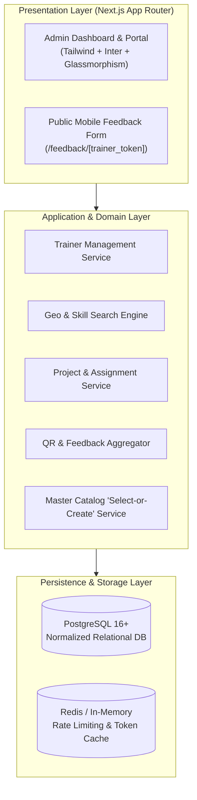
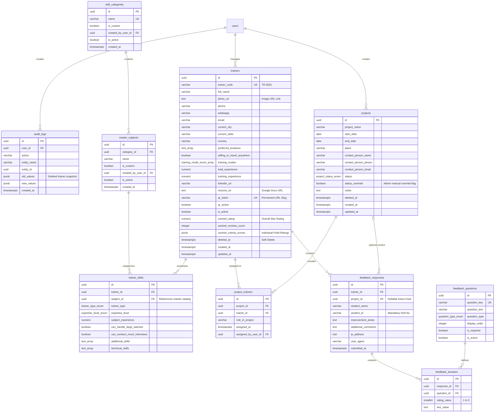

# EdRealm — Software Requirements Specification (SRS)

> **Document Version**: 1.1.0  
> **Status**: Approved for Development (Database Architecture Finalized)  
> **Target Release**: MVP (Production Foundation)  
> **Associated Documents**: [`prd.md`](./prd.md) | [`design.md`](./design.md)

---

## 1. Introduction & Architectural Vision

### 1.1 Purpose
This Software Requirements Specification (SRS) defines the technical architecture, data models, API contracts, functional specifications, and non-functional guarantees for **EdRealm**. 

### 1.2 "MVP-to-Product" Architectural Tenet
This MVP is architected as the **permanent production foundation** of EdRealm, not a disposable prototype. Every component, database entity, and service layer is designed to scale directly into post-MVP capabilities (such as multi-batch training schedules, college portals, payroll automation, and automated trainer matching) without structural refactoring or data migration breaking changes.



---

## 2. Technology Stack & Infrastructure

| Layer | Technology | Selection Rationale |
| :--- | :--- | :--- |
| **Framework** | **Next.js 15+ (App Router)** | Full-stack React with Server Components, API Route Handlers, and Server Actions. Provides optimized SSR for the admin portal and ultra-fast lightweight rendering for mobile QR feedback forms. |
| **Language** | **TypeScript 5.5+** | End-to-end strict type safety sharing schema contracts between client and server via Zod. |
| **Styling & UI** | **Tailwind CSS + Lucide Icons** | Implements the reverse-engineered `design.md` Neo-Clean Glassmorphic design system (`Inter` font stack, slate/indigo/emerald tokens, rounded pills, frosted glass cards). |
| **Database** | **PostgreSQL 16+** | ACID-compliant relational persistence with native support for `UUIDv4`, `JSONB` for audit logs & rating breakdowns, full-text search, and array fields. |
| **ORM / Query Engine** | **Drizzle ORM** (or **Prisma**) | Lightweight, zero-overhead, type-safe SQL-like query builder that facilitates easy schema migrations and optimal query generation. |
| **Cache & Rate Limiting** | **Upstash Redis / Token Bucket** | Daily Roll Number deduplication and bot prevention on public feedback submission routes. |
| **Media & Resumes** | **Google Docs & Image URL Links** | Zero storage hosting cost. Resumes are stored as live Google Docs links (`resume_url`), and photos as direct image links (`photo_url`) with dynamic initials avatar fallbacks. |
| **QR Code Engine** | **`qrcode` (Node.js)** | Dynamic server-side generation of high-resolution vector SVGs and PNG buffers. |
| **Validation** | **Zod 3.x** | Centralized validation schemas reused across client forms and server endpoints. |

---

## 3. Finalized Database Architecture & Schema

The database is normalized to 3NF with audit trails, soft-delete mechanisms, and compound indexes to support high-performance search queries.



---

### 3.1 Production PostgreSQL DDL Script

```sql
-- 1. Enable Required Extensions
CREATE EXTENSION IF NOT EXISTS "uuid-ossp";
CREATE EXTENSION IF NOT EXISTS "pgcrypto";

-- 2. Custom Enumerations
CREATE TYPE user_role AS ENUM ('super_admin', 'admin', 'coordinator');
CREATE TYPE training_mode AS ENUM ('Offline', 'Online', 'Hybrid');
CREATE TYPE trainer_type AS ENUM ('Technical', 'Aptitude', 'Soft Skills', 'Domain Expert');
CREATE TYPE expertise_level AS ENUM ('Beginner', 'Intermediate', 'Advanced', 'Expert');
CREATE TYPE project_status AS ENUM ('upcoming', 'ongoing', 'completed', 'cancelled');
CREATE TYPE question_type AS ENUM ('rating', 'text');

-- 3. Sequences
CREATE SEQUENCE IF NOT EXISTS trainer_code_seq START 1;

-- 4. Users Table (Admin & Staff)
CREATE TABLE users (
    id UUID PRIMARY KEY DEFAULT gen_random_uuid(),
    email VARCHAR(255) UNIQUE NOT NULL,
    password_hash VARCHAR(255) NOT NULL,
    full_name VARCHAR(128) NOT NULL,
    role user_role NOT NULL DEFAULT 'admin',
    is_active BOOLEAN NOT NULL DEFAULT TRUE,
    created_at TIMESTAMPTZ NOT NULL DEFAULT NOW(),
    updated_at TIMESTAMPTZ NOT NULL DEFAULT NOW()
);

-- 5. Master Skill Categories & Subjects ("Select-or-Create" Combobox)
CREATE TABLE skill_categories (
    id UUID PRIMARY KEY DEFAULT gen_random_uuid(),
    name VARCHAR(64) NOT NULL,
    is_custom BOOLEAN NOT NULL DEFAULT FALSE,
    created_by_user_id UUID REFERENCES users(id) ON DELETE SET NULL,
    display_order INTEGER NOT NULL DEFAULT 0,
    is_active BOOLEAN NOT NULL DEFAULT TRUE,
    created_at TIMESTAMPTZ NOT NULL DEFAULT NOW()
);
CREATE UNIQUE INDEX idx_unique_category_name_ci ON skill_categories (LOWER(TRIM(name)));

CREATE TABLE master_subjects (
    id UUID PRIMARY KEY DEFAULT gen_random_uuid(),
    category_id UUID NOT NULL REFERENCES skill_categories(id) ON DELETE RESTRICT,
    name VARCHAR(64) NOT NULL,
    is_custom BOOLEAN NOT NULL DEFAULT FALSE,
    created_by_user_id UUID REFERENCES users(id) ON DELETE SET NULL,
    is_active BOOLEAN NOT NULL DEFAULT TRUE,
    created_at TIMESTAMPTZ NOT NULL DEFAULT NOW()
);
CREATE UNIQUE INDEX idx_unique_subject_per_category_ci ON master_subjects (category_id, LOWER(TRIM(name)));

-- 6. Trainers Table
CREATE TABLE trainers (
    id UUID PRIMARY KEY DEFAULT gen_random_uuid(),
    trainer_code VARCHAR(16) UNIQUE NOT NULL 
        DEFAULT ('TR-' || LPAD(nextval('trainer_code_seq')::TEXT, 4, '0')),
    full_name VARCHAR(128) NOT NULL,
    photo_url TEXT,                         -- Image link with fallback initials
    phone VARCHAR(20) NOT NULL,
    whatsapp VARCHAR(20) NOT NULL,
    email VARCHAR(255) NOT NULL,
    current_city VARCHAR(64) NOT NULL,
    current_state VARCHAR(64) NOT NULL,
    country VARCHAR(64) NOT NULL DEFAULT 'India',
    preferred_locations TEXT[] NOT NULL DEFAULT '{}',
    willing_to_travel_anywhere BOOLEAN NOT NULL DEFAULT FALSE,
    training_modes training_mode[] NOT NULL DEFAULT '{Offline}',
    total_experience NUMERIC(4,1) NOT NULL DEFAULT 0.0,
    training_experience NUMERIC(4,1) NOT NULL DEFAULT 0.0,
    linkedin_url TEXT,
    resume_url TEXT,                        -- Google Docs / Drive URL link
    qr_token VARCHAR(64) UNIQUE NOT NULL,   -- Cryptographic 32-char slug
    qr_active BOOLEAN NOT NULL DEFAULT TRUE,
    is_active BOOLEAN NOT NULL DEFAULT TRUE,
    cached_rating NUMERIC(3,2) NOT NULL DEFAULT 0.00,
    cached_reviews_count INTEGER NOT NULL DEFAULT 0,
    cached_criteria_scores JSONB NOT NULL DEFAULT '{
        "knowledge": 0.00,
        "concept_clarity": 0.00,
        "problem_solving": 0.00,
        "doubt_clarification": 0.00,
        "communication": 0.00,
        "punctuality": 0.00,
        "overall_satisfaction": 0.00
    }'::jsonb,
    deleted_at TIMESTAMPTZ,
    created_at TIMESTAMPTZ NOT NULL DEFAULT NOW(),
    updated_at TIMESTAMPTZ NOT NULL DEFAULT NOW()
);

-- 7. Trainer Skills (Multi-Skill records)
CREATE TABLE trainer_skills (
    id UUID PRIMARY KEY DEFAULT gen_random_uuid(),
    trainer_id UUID NOT NULL REFERENCES trainers(id) ON DELETE CASCADE,
    subject_id UUID NOT NULL REFERENCES master_subjects(id) ON DELETE RESTRICT,
    trainer_type trainer_type NOT NULL DEFAULT 'Technical',
    expertise_level expertise_level NOT NULL DEFAULT 'Intermediate',
    subject_experience NUMERIC(4,1) NOT NULL DEFAULT 0.0,
    can_handle_large_batches BOOLEAN NOT NULL DEFAULT FALSE,
    can_conduct_mock_interviews BOOLEAN NOT NULL DEFAULT FALSE,
    additional_skills TEXT[] NOT NULL DEFAULT '{}',
    technical_skills TEXT[] NOT NULL DEFAULT '{}',
    created_at TIMESTAMPTZ NOT NULL DEFAULT NOW(),
    UNIQUE(trainer_id, subject_id)
);

-- 8. Projects Table
CREATE TABLE projects (
    id UUID PRIMARY KEY DEFAULT gen_random_uuid(),
    project_name VARCHAR(255) NOT NULL,
    start_date DATE NOT NULL,
    end_date DATE NOT NULL,
    place VARCHAR(128) NOT NULL,
    contact_person_name VARCHAR(128) NOT NULL,
    contact_person_phone VARCHAR(20) NOT NULL,
    contact_person_email VARCHAR(255),
    status project_status NOT NULL DEFAULT 'upcoming',
    status_override BOOLEAN NOT NULL DEFAULT FALSE,
    notes TEXT,
    deleted_at TIMESTAMPTZ,
    created_at TIMESTAMPTZ NOT NULL DEFAULT NOW(),
    updated_at TIMESTAMPTZ NOT NULL DEFAULT NOW(),
    CONSTRAINT chk_project_dates CHECK (end_date >= start_date)
);

-- 9. Project Trainers Junction Table
CREATE TABLE project_trainers (
    id UUID PRIMARY KEY DEFAULT gen_random_uuid(),
    project_id UUID NOT NULL REFERENCES projects(id) ON DELETE CASCADE,
    trainer_id UUID NOT NULL REFERENCES trainers(id) ON DELETE RESTRICT,
    role_in_project VARCHAR(64) NOT NULL DEFAULT 'Trainer',
    assigned_by_user_id UUID REFERENCES users(id) ON DELETE SET NULL,
    assigned_at TIMESTAMPTZ NOT NULL DEFAULT NOW(),
    UNIQUE(project_id, trainer_id)
);

-- 10. Global Dynamic Feedback Questions (Admin Settings)
CREATE TABLE feedback_questions (
    id UUID PRIMARY KEY DEFAULT gen_random_uuid(),
    question_key VARCHAR(64) UNIQUE NOT NULL,
    question_text VARCHAR(255) NOT NULL,
    question_type question_type NOT NULL DEFAULT 'rating',
    display_order INTEGER NOT NULL DEFAULT 0,
    is_required BOOLEAN NOT NULL DEFAULT TRUE,
    is_active BOOLEAN NOT NULL DEFAULT TRUE,
    created_at TIMESTAMPTZ NOT NULL DEFAULT NOW(),
    updated_at TIMESTAMPTZ NOT NULL DEFAULT NOW()
);

-- 11. Student Feedback Submissions & Answers
CREATE TABLE feedback_responses (
    id UUID PRIMARY KEY DEFAULT gen_random_uuid(),
    trainer_id UUID NOT NULL REFERENCES trainers(id) ON DELETE CASCADE,
    project_id UUID REFERENCES projects(id) ON DELETE SET NULL,
    student_name VARCHAR(128),
    student_id VARCHAR(64) NOT NULL,        -- Mandatory Roll Number
    improvement_areas TEXT,
    additional_comments TEXT,
    ip_address INET,
    user_agent VARCHAR(255),
    submitted_at TIMESTAMPTZ NOT NULL DEFAULT NOW()
);

-- Daily Unique Constraint: One submission per Student Roll No per Trainer per calendar day
CREATE UNIQUE INDEX idx_unique_student_feedback_daily 
ON feedback_responses (trainer_id, LOWER(TRIM(student_id)), (submitted_at::DATE));

CREATE TABLE feedback_answers (
    id UUID PRIMARY KEY DEFAULT gen_random_uuid(),
    response_id UUID NOT NULL REFERENCES feedback_responses(id) ON DELETE CASCADE,
    question_id UUID NOT NULL REFERENCES feedback_questions(id) ON DELETE RESTRICT,
    rating_value SMALLINT CHECK (rating_value BETWEEN 1 AND 5),
    text_value TEXT,
    UNIQUE(response_id, question_id)
);

-- 12. Audit Logs Table (Captures Deletion Snapshots)
CREATE TABLE audit_logs (
    id UUID PRIMARY KEY DEFAULT gen_random_uuid(),
    user_id UUID REFERENCES users(id) ON DELETE SET NULL,
    action VARCHAR(64) NOT NULL,
    entity_name VARCHAR(64) NOT NULL,
    entity_id UUID NOT NULL,
    old_values JSONB,                       -- Complete snapshot before update/delete
    new_values JSONB,
    created_at TIMESTAMPTZ NOT NULL DEFAULT NOW()
);

-- 13. High-Performance B-Tree & GIN Indexes
CREATE INDEX idx_trainers_search_geo ON trainers (current_city, current_state) WHERE deleted_at IS NULL;
CREATE INDEX idx_trainers_rating ON trainers (cached_rating DESC) WHERE is_active = TRUE AND deleted_at IS NULL;
CREATE INDEX idx_trainers_qr ON trainers (qr_token) WHERE qr_active = TRUE;
CREATE INDEX idx_trainers_pref_locs ON trainers USING GIN (preferred_locations);
CREATE INDEX idx_trainer_skills_subject ON trainer_skills (subject_id, trainer_id);
CREATE INDEX idx_projects_status_dates ON projects (status, start_date, end_date) WHERE deleted_at IS NULL;
CREATE INDEX idx_feedback_trainer_date ON feedback_responses (trainer_id, submitted_at DESC);
```

---

## 4. Operational Logic & Service Specifications

### 4.1 Master Catalog "Select-or-Create" Combobox
- In the UI, the category and subject dropdowns include **`+ Other`**.
- When an admin enters a new item, the backend checks `LOWER(TRIM(name))`. If it exists, it reuses the ID; if new, it atomically inserts into `skill_categories` or `master_subjects` with `is_custom = TRUE` and `created_by_user_id = current_admin_id`.
- Instantly available to all future trainers.

### 4.2 Rating Aggregation Engine
- When feedback is submitted, the transaction updates `trainers`:
  - `cached_rating` = Total sum of all submitted star ratings / Total rating count.
  - `cached_criteria_scores` = Individual averages per `question_key` (`knowledge`, `concept_clarity`, `problem_solving`, etc.).
  - `cached_reviews_count` = Count of unique feedback response submissions.

### 4.3 3-Tier Geo-Search Algorithm
- Search for a city (e.g. *Vijayawada*) executes:
  ```sql
  ORDER BY 
    CASE 
      WHEN LOWER(trainers.current_city) = LOWER(:search_city) THEN 1  -- Tier 1: Local
      WHEN :search_city = ANY(trainers.preferred_locations) THEN 2   -- Tier 2: Preferred
      WHEN trainers.willing_to_travel_anywhere = TRUE THEN 3         -- Tier 3: Travel Anywhere
      ELSE 4                                                         -- Tier 4: Outstation
    END ASC,
    trainers.cached_rating DESC,
    trainers.total_experience DESC
  ```

### 4.4 Project Overlap Warning
- When adding a trainer to a project, the API executes:
  ```sql
  SELECT p.project_name, p.start_date, p.end_date 
  FROM project_trainers pt
  JOIN projects p ON pt.project_id = p.id
  WHERE pt.trainer_id = :trainer_id 
    AND p.status != 'cancelled'
    AND (p.start_date <= :new_end_date AND p.end_date >= :new_start_date);
  ```
- If an overlap exists, the API returns a `409 Conflict` warning payload with the conflicting project names. The admin can confirm with `{ forceOverride: true }` to finalize assignment.

### 4.5 GitHub-Style Deletion Modal
- Deleting a trainer requires the admin to type **`DELETE TR-XXXX/<Trainer Name>`**.
- Before marking `deleted_at = NOW()` and `is_active = FALSE`, the backend writes the entire trainer JSON record into `audit_logs.old_values`.

### 4.6 Automatic Project Status with Manual Override
- When retrieved, if `status_override = FALSE`:
  - `CURRENT_DATE < start_date` → `upcoming`
  - `CURRENT_DATE BETWEEN start_date AND end_date` → `ongoing`
  - `CURRENT_DATE > end_date` → `completed`
- If an admin clicks *"Mark Completed"* or *"Cancel"*, `status_override` is set to `TRUE`, freezing the status.

---

## 5. API, Server Actions & Route Handlers Specification

Mutations in EdRealm use **Next.js Server Actions** for zero-overhead client-server communication and instant cache revalidation (`revalidatePath`). Public integrations, QR vector streaming, and CSV exports use dedicated **Route Handlers** (`/api/...`).

### 5.1 Server Actions (`actions/`)

#### 1. Trainer Actions (`actions/trainers.ts`)
- **`createTrainer(formData: CreateTrainerInput)`**:
  - Validates payload via Zod `CreateTrainerSchema`.
  - Executes "Select-or-Create" on categories and subjects.
  - Inserts trainer and skill records in a single database transaction.
  - Generates 32-character nanoid `qr_token`.
  - Revalidates `/trainers`.
- **`updateTrainer(id: string, formData: UpdateTrainerInput)`**:
  - Updates personal info, Google Docs resume URL, photo URL, and travel preferences.
  - Revalidates `/trainers` and `/trainers/[id]`.
- **`deleteTrainer(id: string, confirmationPhrase: string)`**:
  - Validates `confirmationPhrase === 'DELETE TR-XXXX/<Name>'`.
  - Writes full trainer JSON snapshot to `audit_logs.old_values`.
  - Sets `deleted_at = NOW()` and `is_active = FALSE`.
  - Revalidates `/trainers`.
- **`toggleTrainerStatus(id: string, isActive: boolean)`**:
  - Toggles `is_active`.
  - Revalidates `/trainers`.
- **`toggleQrActive(id: string, qrActive: boolean)`**:
  - Toggles feedback form availability.
  - Revalidates `/trainers/[id]`.
- **`regenerateQrToken(id: string)`**:
  - Cycles `qr_token` with new 32-char nanoid.
  - Revalidates `/trainers/[id]`.

#### 2. Project Actions (`actions/projects.ts`)
- **`createProject(formData: CreateProjectInput)`**:
  - Validates `CreateProjectSchema` (start/end dates, name, place, POC).
  - Inserts project and returns `{ id }` for instant client redirect to `/projects/[id]`.
  - Revalidates `/projects`.
- **`updateProject(id: string, formData: UpdateProjectInput)`**:
  - Updates project metadata.
  - Revalidates `/projects/[id]`.
- **`assignTrainerToProject(projectId: string, trainerId: string, options?: { forceOverride?: boolean })`**:
  - Runs date overlap query on `project_trainers` + `projects`.
  - If conflict exists and `forceOverride !== true`, returns `{ conflict: true, conflictingProjects: [...] }`.
  - If confirmed, inserts into `project_trainers`.
  - Revalidates `/projects/[id]`.
- **`unassignTrainerFromProject(projectId: string, trainerId: string)`**:
  - Removes record from `project_trainers`.
  - Revalidates `/projects/[id]`.
- **`overrideProjectStatus(id: string, status: ProjectStatus)`**:
  - Sets `status` and `status_override = TRUE`.
  - Revalidates `/projects/[id]` and `/projects`.

#### 3. Question Builder Actions (`actions/questions.ts`)
- **`createQuestion(formData: CreateQuestionInput)`**:
  - Adds new dynamic question to global catalog.
  - Revalidates `/settings` and public feedback form.
- **`updateQuestion(id: string, formData: UpdateQuestionInput)`**:
  - Updates text or required status.
  - Revalidates `/settings`.
- **`reorderQuestions(orderedIds: string[])`**:
  - Batch updates `display_order`.
  - Revalidates `/settings`.
- **`toggleQuestionActive(id: string, isActive: boolean)`**:
  - Globally enables/disables question.
  - Revalidates `/settings`.

---

### 5.2 API Route Handlers (`app/api/...`)

#### 1. Public Student Feedback API
- **`GET /api/public/feedback/[qr_token]`**:
  - Publicly accessible (no authentication required).
  - Validates token, checks `qr_active`.
  - Returns trainer name, photo URL, and list of active `feedback_questions` sorted by `display_order`.
- **`POST /api/public/feedback/[qr_token]`**:
  - Validates mandatory Student Roll Number (`student_id`).
  - Validates empty honeypot field (`website_url`).
  - Enforces daily unique constraint `idx_unique_student_feedback_daily`. If duplicate, returns `409 Conflict` (*"You have already submitted feedback today."*).
  - Inserts `feedback_responses` and `feedback_answers`.
  - Atomically recalculates `cached_rating` and `cached_criteria_scores` on the `trainers` table.

#### 2. Vector QR Image Stream API
- **`GET /api/trainers/[id]/qr`**:
  - Query params: `format=svg|png`, `size=512`, `download=true`.
  - Generates vector QR code pointing to `https://<domain>/feedback/[qr_token]`.
  - Streams SVG or PNG image buffer directly to the browser for high-resolution printing.

#### 3. CSV Export Stream API
- **`GET /api/trainers/export`**:
  - Accepts same filter query parameters as directory search (`city`, `subject`, `minRating`, etc.).
  - Streams formatted CSV spreadsheet with trainer names, contact details, ratings, and experience.

---

## 6. Form State, Client Validation & UI Notifications

All administrative forms implement **React Hook Form + Zod + Sonner Toasts**:
1. **Real-time Client Validation**:
   - Immediate feedback on phone numbers (`+91 XXXXX XXXXX`), valid Google Docs URLs, email formats, and required inputs before submitting.
2. **Optimistic Loading Feedback**:
   - Action buttons display loading spinners and disable duplicate clicks (`isSubmitting` / `useTransition().isPending`).
3. **Sonner Toast System**:
   - Modern, sleek toasts anchored at the top-right corner styled with our `design.md` tokens:
     - Success: Emerald accent border (`#10B981`) with confirmation message.
     - Warning: Amber warning toast for project date overlaps with an inline **"Proceed Anyway"** button.
     - Error: High-contrast slate alert on validation failure.

---

## 7. Security, Seeding & Abuse Prevention

1. **Super Admin Seeding (`npm run db:seed`)**:
   - Automatically initializes the database with:
     - Default Super Admin: `admin@edrealm.in`.
     - Seeded `skill_categories` (Programming & DSA, Full Stack, AI/ML, Cloud & DevOps, Aptitude & Soft Skills).
     - Seeded `master_subjects` (Java DSA, Python Full Stack, Generative AI, Quantitative Aptitude, Verbal Ability, etc.).
     - 7 default `feedback_questions`.
2. **Student Feedback Protection**:
   - Classroom Wi-Fi compatible: no shared IP blocking.
   - Enforces unique Student Roll Number per trainer per calendar day.
   - Invisible honeypot field silently drops automated bot scripts.

---

## 8. MVP-to-Product Extensibility Roadmap

The database schema and service layers provide direct hook points for post-MVP enhancements:

```
[MVP Baseline]                               [Phase 2: Post-MVP Extensions]
trainers table ----------------------------> trainer_availability (Calendar & Busy Slots)
project_trainers junction ------------------> project_batches (Multi-batch time allocations)
feedback_responses ------------------------> sentiment_analysis_score (AI NLP Feedback Parsing)
users & auth -------------------------------> college_portal_tenants (Multi-Tenant College Access)
```
